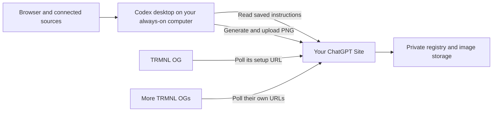

# AI TRMNL

Give Codex this repository. Get a small screen with a personality.

AI TRMNL is a reusable ChatGPT Site that stores instructions and images for your TRMNL OG displays. An always-on computer running the **Codex desktop app** gathers information, generates images, and uploads them to your Site. The displays wake up, fetch their own images, and go back to their very demanding nap schedule.

## Start here

Copy this into Codex desktop:

> Use https://github.com/brianpattison/ai-trmnl to help me set up my own TRMNL device. Read the repository's AGENTS.md and docs/setup.md.

You need:

- A **TRMNL OG**, Wi-Fi, and firmware supporting custom servers. The original prototype was physically verified on OG firmware 1.8.17.
- Your own account with **Codex desktop and the Sites plugin** available.
- A dedicated computer that stays awake with Codex running. There is no cloud scheduler in this design.
- Node.js 22.13+ for building the Site, and Python 3.10+ for the portable renderer. Codex helps prepare these.

No Google Calendar connection is needed for the first weather screen. Connect calendars or other sources only when you want that content.

## What happens during setup

1. Codex reads these instructions and creates **your own Site**. It generates a random token and sets it as the Site's secret `SITE_TOKEN` environment variable.
2. Codex guesses a city from available context, fetches real weather for that city, and publishes a clearly labeled weather-only starter screen. The guess can be changed later.
3. You receive a private management link, shaped like `https://your-site.chatgpt.site/?token=YOUR_SECRET`, and a copyable **Custom Server** URL for the starter screen.
4. You make the Site public using Sites sharing controls, so the physical device can reach it. The application still checks its secret token and per-screen keys.
5. Codex walks you through the TRMNL Wi-Fi portal. Paste the complete Custom Server URL shown for that screen. Confirm what appears on the physical display.
6. Describe your preferred dashboard to Codex. It saves instructions for each screen on the Site and helps configure a local hourly task.

Invalid or missing management tokens return **404**. Each screen gets a separate read-only setup key derived from the master token. A setup URL looks like `/d/SCREEN_ID/DEVICE_KEY`; firmware appends its standard `/api/setup` and `/api/display` paths. The token is deliberately in the management URL, so treat that link like a password.

## How updates work

Each logical screen has its own name, instructions, revision, scene, publication, polling interval, and delivery status. There is no fixed two-device limit. Multiple physical displays can share one logical screen if you want identical content.

Codex generation and device polling are separate. The intended default is **hourly generation** and **five-minute device polling**. If the computer, browser, or a source is unavailable, the Site keeps serving the last successful image. Source timestamps remain visible on the display.

The Site never receives your Google password or signs in to weather services. Codex uses the sources you authorize on the updater computer. Browser approval prompts can still interrupt a local scheduled task; test the workflow and its permissions before relying on it.

## Repository map

| Path | Purpose |
| --- | --- |
| `site/` | Site source: screen management, authenticated API, firmware routes, D1 registry, R2 images |
| `updater/` | Portable Python image renderer, HTTP client, fonts and tests |
| `docs/setup.md` | Codex's complete first-run playbook |
| `docs/updater.md` | Local recurring-update procedure and prompt template |
| `docs/api.md` | API contract, revisions, retries and image requirements |
| `docs/development.md` | Local development, checks and publication workflow |
| `legacy/macos/` | Historical native prototype; not required by the Site |

**Keep household data out of Git.** Local tokens, actual deployment IDs, images, source snapshots, and connection files belong in ignored `.runtime/` or ignored local environment files. This repository contains reusable code and instructions, not anyone's dashboard data. Generated Site publishing checkouts have their own deployment manifest.

## Status and boundaries

The Site implementation is privately deployed and its hosted firmware/image routes have passed protocol checks. The earlier native prototype and its weather/calendar layout were verified on a physical OG; physical pairing with the hosted replacement is still pending. The portable updater and new-owner onboarding remain under development. See [verification](docs/verification.md) for current evidence.

Supported output is **800×480, 1-bit or 2-bit grayscale PNG, at most 90,000 bytes**. Other TRMNL models and dimensions are not yet supported. The starter renderer draws a weather screen without ImageGen. The companion template combines generated scene art with deterministic weather/calendar text.

The Site stores images and serves firmware requests; it does not generate content itself. No cloud scheduled task is created. A publication receipt proves that an image was saved, and a response timestamp proves only that the server prepared an image response—not that the device displayed it.

[Setup guide](docs/setup.md) · [Updater guide](docs/updater.md) · [API](docs/api.md)
