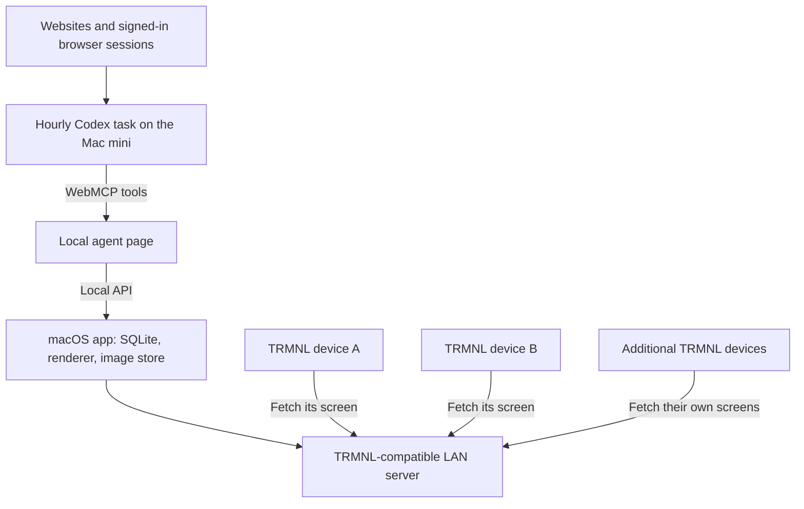

# AI TRMNL

A small macOS menu bar app that serves Codex-generated screens to TRMNL devices on your local network. Codex gathers the information, decides what belongs on each screen, and updates it every hour. The displays do what they do best: sit quietly and look informed.

**Status: planning.** This repository documents the intended product and initial architecture. The app, server, renderer, and scheduled task are not implemented yet.

## What we are building

- Install one app on a Mac mini and have it start automatically at login.
- Pair as many TRMNL devices as the household needs, without a hard-coded device count. Actual capacity will depend on the Mac and generation workload.
- Give every device its own content, layout, preferences, and current image.
- Tell Codex what to display and how it should look. Save those decisions so future runs stay consistent.
- Start by giving Codex the app's local URL. The homepage explains how to pair devices, design their dashboards with the user, and operate the server.
- Have an hourly Codex task browse Google Calendar, weather websites, and other requested sources, then publish updated screens through WebMCP.
- Keep the app small: device management, local rendering, image delivery, and a minimal agent page. The only human-facing web content is plain connection/disconnection help. Dashboard creation and editing happen in conversation with Codex; the app has no built-in integrations with external data services.

The initial installation has **two TRMNL OG devices in the same house on the same network, displaying different content**. These are the first two entries in a general device registry, not two fixed slots.

## Start with one local address

The intended user experience is: install the app, copy its agent URL from the menu bar, and tell Codex, “Open this address and help me set up my TRMNL displays.” On the Mac mini, an example would be `http://localhost:8788/`.

That first page is an agent handbook as well as the WebMCP entry point. It should contain readable instructions even before tools are discovered: what the app does, its version and capabilities, the available tools and their effects, the device-facing server address, connection/disconnection steps, image requirements, and how to verify publication. Serve the handbook and tool documentation from the same version of the app so instructions stay aligned with behavior. Using the installed app should not require reading this repository. A person visiting the address gets a simple help page, with no dashboard editor, settings panels, or drag-and-drop widgets.

Codex should use that page to guide a conversation:

1. Check the server and discover existing devices before starting another pairing attempt.
2. Help the user connect each TRMNL, explain the physical button/Wi-Fi steps, and verify its identity with a labeled test screen.
3. Ask what each display should show, which websites provide it, and what layout, units, timezone, and privacy preferences fit its location.
4. Gather sample content, build a dashboard preview, and refine it with the user.
5. Save the chosen profile and template, publish the screen, and check the result on that device.
6. Once the workflow works, help set up the hourly Codex task using those saved profiles.

The page gives the agent capabilities and usage documentation. The user's request supplies the authority to act. Pairing still requires the user to operate the physical device, and source websites may require the user to sign in. After setup, routine refreshes reuse the saved choices.

## How it works



TRMNL devices **pull** their screens. A device wakes up, requests display metadata, downloads an image when needed, renders it, and sleeps. The Mac serves the newest published image whenever that device checks in; it does not initiate a connection to a sleeping display. [TRMNL architecture](https://docs.trmnl.com/go/how-it-works)

Image generation and device polling have separate schedules. The proposed starting point is hourly content generation and a configurable 15-minute device poll. That gives a healthy device up to roughly 15 minutes to pick up a newly published screen. Hourly polling uses fewer wakeups but can add nearly an hour of delivery delay. Neither setting guarantees an exact wall-clock display update.

## Proposed macOS app

Use Swift and SwiftUI for a native menu bar utility, with a small embedded HTTP server, SQLite, and a local renderer. Pick the server and rendering libraries during the first prototype; there is no need for a separate database server, container runtime, or full web framework.

The native menu should stay small: server status, Copy Agent URL, the address to use during pairing, launch-at-login, and quit. A pairing shortcut and compact device status can be added if useful. Content editing, previews, preferences, and guided onboarding happen through Codex.

Apple provides [MenuBarExtra](https://developer.apple.com/documentation/swiftui/menubarextra) for the menu bar and [SMAppService.mainApp](https://developer.apple.com/documentation/servicemanagement/smappservice/mainapp) for launch-at-login. Login startup is distinct from booting before a user signs in. The first version assumes the Mac mini has a logged-in user session. A pre-login server would require a separate service, and would not by itself make Codex's browser automation available.

## Pairing TRMNL devices

TRMNL supports Bring Your Own Server (BYOS). Its Wi-Fi setup portal lets you choose a custom server URL. We should start with the official firmware's supported configuration, then check the actual firmware versions on the household's devices. [BYOS guide](https://docs.trmnl.com/go/diy/byos), [custom-server setup](https://docs.trmnl.com/go/diy/byod-s)

Planned setup flow:

1. Start the Mac app and reserve the Mac mini's LAN IP address in the router so its address remains stable.
2. Ask Codex to start pairing through the local agent page, or choose Add Device in the menu bar app, to open a short pairing window.
3. Put one OG into Wi-Fi pairing mode, join its temporary TRMNL network from a phone or computer, and open its setup portal. TRMNL's current OG instructions say to hold the rear boot button for 6–8 seconds. [Pairing instructions](https://help.trmnl.com/en/articles/11511577-enable-wifi-pairing-mode)
4. Select the household Wi-Fi and Custom Server, then enter the address shown by the app, such as `http://192.168.1.50:8787`. This is an example address, not an existing service.
5. Let the device register, confirm its identity with Codex, and assign a friendly name and content profile. Show a unique identification screen to verify the physical device mapping.
6. Repeat for every additional device, using the same server address and a different device profile.

The OG needs 2.4 GHz Wi-Fi. The Mac may use Ethernet or Wi-Fi, provided the devices can reach it; guest-network isolation and firewalls can prevent that. Use the Mac's reachable LAN address, not `localhost`, in device configuration. [TRMNL network guidance](https://help.trmnl.com/en/articles/10193157-device-wifi-troubleshooting)

Provision a separate local API token for each registered device. Pairing must not silently enroll arbitrary devices outside the pairing window. Changing the server may require re-provisioning stored credentials; confirm the exact behavior on the installed firmware. BYOS replaces the hosted content pipeline, so Codex becomes responsible for the content that would otherwise come from TRMNL plugins. [TRMNL plugin types](https://help.trmnl.com/en/articles/10546870-compare-custom-plugin-types)

### Disconnecting a device

Ask Codex to disconnect the named device. The app should retire its registration, revoke its device access and image-download credentials, and stop including it in scheduled refreshes. Preserve the saved dashboard so it can be reused; deleting that definition is a separate request.

The help page should walk the user through reopening the TRMNL's Wi-Fi portal and choosing another server or the firmware's official hosted-server option. Revoking access in this app does not change the server configured on the physical device or erase pixels already displayed. If desired, publish a neutral screen and confirm it on the device before disconnecting it.

## Images and device protocol

The initial rendering target is the OG's **800 × 480 pixels**, using a **1-bit black-and-white BMP3** as a conservative starting format. PNG is also supported on compatible firmware; TRMNL documents PNG support from firmware 1.5.2 and four-gray OG output from 1.6.0. Its current OG PNG size limit is 90,000 bytes. Record capabilities per device and validate files before publishing. [Image generation guide](https://docs.trmnl.com/go/diy/imagemagick-guide), [device models](https://trmnl.com/api/models)

The small LAN server needs these routes:

| Route | Purpose |
| --- | --- |
| `GET /api/setup` | Provision a recognized device using its `ID` header and return its API key and setup image. |
| `GET /api/display` | Authenticate the device and return its current image URL, filename, and polling interval. |
| `POST /api/log` | Receive bounded device diagnostics. |
| `GET /screens/...` | Serve the published image bytes. This path is our choice. |

The first three follow the [TRMNL BYOS API](https://docs.trmnl.com/go/diy/byos#api). Match response fields and headers to the firmware we test, including setup's `status: 200` and display's `status: 0`.

Every changed image needs a new `filename`: the firmware uses it as a cache key. Use immutable, versioned image files, with each device's database record pointing to its current version. A stable filename such as `current.bmp` would risk leaving yesterday's weather on today's screen. [TRMNL image caching](https://docs.trmnl.com/go/diy/byod-s)

Keep firmware-update and reset flags disabled in ordinary display responses. The first version is a content server; firmware maintenance remains a separate operation.

## WebMCP as the agent interface

The app will serve the agent handbook as a minimal top-level page for Codex to visit locally. That page registers JavaScript tools with `document.modelContext.registerTool()`, and their handlers call the app's local API. Return preview images to Codex for inspection and discussion with the user; a web preview gallery is unnecessary. Tool results should report the next useful step, such as waiting for a device, choosing a profile, or checking a published screen.

WebMCP is a browser-page interface, not a replacement for the HTTP server or a background MCP server. Its tools depend on the page being available. OpenAI documents site-tool support in Codex's built-in browser, with availability depending on the model, app, rollout, and permissions. It currently supports imperative tools in the top-level page, rather than iframe tools or declarative forms. [OpenAI site tools](https://learn.chatgpt.com/docs/webmcp)

Proposed tools, to be implemented and tested:

| Tool | Purpose |
| --- | --- |
| `get_server_info` | Read capabilities, handbook links, readiness, and the LAN address devices should use. |
| `start_pairing` | Open a short pairing window and return the device connection instructions. |
| `get_pairing_status` | Inspect pending device registrations without enrolling them. |
| `confirm_device` | Complete the user's selected pairing and assign a stable device ID. |
| `disconnect_device` | Retire the selected registration, revoke its access, and return physical reconnection instructions. |
| `list_devices` | Discover all paired devices and their capabilities. |
| `get_device_profile` | Read one device's content instructions, layout, and profile revision. |
| `save_dashboard` | Save the user's dashboard instructions, source URLs, preferences, and template as a new revision. |
| `render_screen` | Render structured content with a saved template; return an image ID and preview. |
| `publish_screen` | Make a validated image current for one explicit device ID. |
| `get_device_status` | Read publication receipts, current image version, and device check-ins. |

Codex gathers and composes the content; a deterministic local renderer produces the pixels. That keeps calendar text sharp and avoids redesigning the screen every hour. Templates can change when the user asks. `publish_screen` references an image already staged by the renderer, avoiding large bitmap payloads in model tool calls. Direct image import can be added if a future workflow needs it.

Every write should carry a request ID and expected revision. The server validates the target device, rejects stale writes, and returns a committed receipt. After an uncertain response, query the receipt or retry the same request ID with the same input. Publication means the server has accepted the screen; it does not prove the physical display has rendered it.

Keep this adapter thin over ordinary application functions so browser API changes do not require rewriting device delivery. WebMCP remains a draft specification. The first prototype must demonstrate actual tool discovery and invocation from Codex on the target Mac; a JavaScript feature check alone is insufficient. [WebMCP specification](https://webmachinelearning.github.io/webmcp/), [Chrome guide](https://developer.chrome.com/docs/ai/agents)

## SQLite as the app's memory

Use a local SQLite database as the source of truth. Once Codex and the user have refined a dashboard, save everything needed to regenerate it. Each scheduled run reads that saved definition through WebMCP, so a fresh chat can continue the work. SQLite is embedded in the app and does not need a separately operated service. [SQLite application storage](https://www.sqlite.org/appfileformat.html)

The proposed records are:

| Record | What it remembers |
| --- | --- |
| Device | Stable ID, friendly name, hardware identity, capabilities, polling interval, active dashboard, and last check-in. |
| Dashboard revision | Content instructions, source URLs, timezone, units, privacy rules, stale-data behavior, and an exact template revision. |
| Template revision | The reusable layout, typography, spacing, field definitions, and rendering configuration. |
| Publication | Device and dashboard revision, image path/hash, generation time, source freshness, and current/previous version. |
| Write receipt | Request ID, input digest, committed revision, and result for safe retries. |

Store the actual reusable template definition, not just a prose description of what the screen looked like. The user should be able to refine a dashboard once and have later runs fill it with new data. Keep a bounded revision history so an unwanted change can be undone. The app owns database writes; Codex uses its tools instead of editing SQLite directly.

Proposed state location, outside the Git checkout:

```text
~/Library/Application Support/AI TRMNL/
  ai-trmnl.sqlite              # Devices, dashboards, templates, publications
  images/
    <device-id>/               # Validated, immutable image versions
  logs/                        # Bounded diagnostics
```

The two current devices get separate dashboard definitions; future devices follow the same pattern. The room names and actual content choices are still to be decided. Generic templates may be shared, but each device keeps an independent dashboard assignment and current image.

Save user-requested preference changes explicitly. Routine hourly runs refresh content using the saved choices. Share source gathering across devices when useful, while keeping their layouts, publication state, and failures independent.

Keep generic templates and example profiles in Git when implemented. Keep the live database, actual calendar content, browser sessions, generated household screens, and private preferences local. Use Keychain for app-managed secrets; store references to those secrets in SQLite. Add schema migrations and a consistent backup/export path for the database and referenced images.

## Hourly Codex task

The first version relies on Codex's existing browser access. The Mac app will not implement Google OAuth, a weather API client, or its own web scraping system. Codex reads the selected websites using browser sessions that the user has made available, then submits the relevant content to the local app.

Create the schedule after a manual end-to-end run succeeds, preferably as a recurring task in the user's setup chat. Local work requires the host computer and desktop app to be running; project-scoped tasks also require their selected project on disk. Plan for an awake Mac mini with a logged-in user session, and verify that the necessary browser tools, sign-ins, local page, and permissions work during an unattended run. [OpenAI scheduled tasks](https://learn.chatgpt.com/docs/automations?surface=app)

Draft task instructions:

> Every hour, open the AI TRMNL local agent page and discover its WebMCP tools. List all paired devices and read their saved profiles. Use the browser to collect the information each profile requests. Reuse fresh source observations where appropriate, and record source times. Render and inspect a screen for each device using its saved template, then publish it to that device and verify the server receipt. Keep device IDs explicit throughout. Preserve preferences unless the user requested a change. If a source is unavailable, follow the profile's stale-data policy; never invent calendar events or current conditions. Continue other devices if one fails. Report failures or required user action; stay quiet on routine successful runs.

Start with one hourly run covering the registry. Avoid overlapping publications with per-device locks. If browser authentication expires, retain the last valid screen and report the problem. Test locked-session behavior and session expiry before relying on unattended browser collection. One successful interactive run is not that test.

## Reliability and local access

- Validate dimensions, encoding, size, device target, and dashboard revision before publication. Write the complete immutable image first, then commit its publication record and current-image pointer in one SQLite transaction. Keep the previous valid version for recovery; clean up unreferenced files left by interrupted writes.
- Include a visible data timestamp. When gathering fails but rendering works, show a stale/unavailable marker according to the profile. If the entire Mac or generation task is offline, the old image cannot update its own warning.
- Serve cached images independently of Codex's generation process. A failed run must not make the device API wait for AI or return a half-written file.
- Put the agent page and write API on a loopback-only listener; expose only the required device protocol and image routes on the LAN listener. Proposed ports are 8788 for the local agent and 8787 for devices.
- Authenticate local writes and check browser origins/hosts. A page being hosted on localhost is not sufficient authorization for a write. Give image downloads their own protection and verify firmware behavior rather than assuming the device forwards its API token to image URLs.
- Plain HTTP on the household LAN is a possible starting point, not encrypted transport. Keep the service off the public internet. Model processing and the websites Codex visits still use external services even though image delivery is local.
- Treat fetched page content as data, not instructions to change profiles or operate unrelated tools. Bound logs, image history, and request sizes so adding devices does not create unbounded storage growth.

## First build milestones

1. **Prove the complete path.** Create the smallest server and self-describing agent homepage. Starting with only its URL, have Codex read the handbook, discover tools, guide pairing, and invoke a publish tool. Verify a uniquely labeled test image on one physical OG. Record the working browser/model and firmware versions.
2. **Prove independent devices.** Register the second OG, publish different images, restart the server, and confirm identities and images persist. Use simulated additional device identities to verify there is no two-device assumption.
3. **Add saved dashboards and rendering.** Define each display's content with the user, save templates and preferences in SQLite, and run browser gathering → render → publish → device fetch manually. Start a fresh Codex chat with only the agent URL and confirm it can reproduce the saved dashboards. Check readability on the actual e-ink screens.
4. **Package and automate.** Add the small menu bar shell, login startup, connection/disconnection help, and an installable app. Enable the hourly Codex task on the Mac mini and test restart recovery, stale data, expired browser sessions, overlapping runs, disconnect/re-pair, and an unattended refresh.

The immediate next step is the first milestone: one real WebMCP publication reaching one real OG. Once that works, the second device should be another registry entry rather than another adventure.

Technical references checked October 13, 2026. Hardware pairing, firmware compatibility, WebMCP availability on the target Mac, and unattended execution still need live validation.
