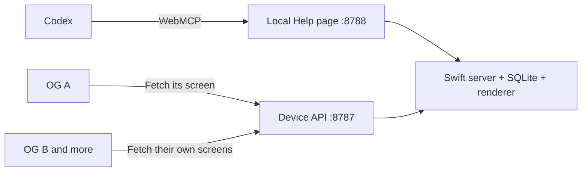

# AI TRMNL

A small macOS menu bar app that serves Codex-generated screens to TRMNL devices on your local network. Codex does the thinking. The displays sit quietly and look informed.

**Status: weather-and-agenda prototype (0.2.0).** The native app, Help page, thirteen WebMCP tools, saved per-device preferences, and deterministic OG renderer are implemented. Codex gathered live Weather Underground data and all accessible Google calendars, saved a dashboard, inspected its preview, and published it through WebMCP. The user confirmed the dashboard appeared on a physical OG running firmware 1.8.17 and that the enlarged agenda text is readable. Login startup, arbitrary layouts, and hourly automation are later milestones.

## Run on your Mac

Requires macOS 13 or later and Xcode Command Line Tools with Swift 5.9 or later. Uses Apple frameworks and the system SQLite library; no package dependencies, account, API key, Docker, or database service.

```sh
./scripts/build-app.sh
open ".build/AI TRMNL.app"
```

The menu bar icon has **Help**, **Copy Agent URL**, and **Quit AI TRMNL**. Help opens your default browser to the starter page at `http://localhost:8788/`. Give Codex the prompt on that page:

> Open http://localhost:8788/ in your built-in browser. Read the agent instructions and discover its WebMCP tools. Help me set up or update my TRMNL display. Discover existing devices and saved dashboard preferences first. Walk me through any physical steps and verify what appears on the display.

The regular browser can display Help without WebMCP support. Codex uses its built-in browser to discover and invoke the tools. The app's help page is the entry point; users do not need this repository to complete setup.

This build is locally ad-hoc signed, not notarized for distribution. Leave the app running and the Mac awake. Automatic login startup is not implemented yet.

For development, run in a terminal instead:

```sh
swift run ai-trmnl --headless
```

The server selects the IPv4 address on the default network interface. If that is a VPN or the wrong interface, specify the Mac's household LAN address:

```sh
swift run ai-trmnl --headless --device-host 192.168.1.50
```

That address is an example. The running Help page reports the actual device server URL. Reserve the Mac's address in your router; restart the app if its address changes. Quit an existing instance before launching another with the same storage or ports.

Other options: `--agent-port 8788`, `--device-port 8787`, `--refresh-seconds 60`, `--data-dir PATH`, and `--ephemeral` (temporary storage and no Keychain, for disposable simulations). Run `swift run ai-trmnl --help` for usage. The one-minute polling default is for this device test; use a longer interval, such as `--refresh-seconds 900`, for normal operation.

## Pair the first TRMNL OG

1. Open Help from the menu bar and give Codex its starter prompt. Codex reads the live capabilities and opens a ten-minute pairing window.
2. On one powered-on OG, hold the rear button for about 6–8 seconds to enter Wi-Fi setup.
3. From a **phone**, join the temporary TRMNL Wi-Fi and open its setup portal. Using a phone keeps the Mac on the household network and available to serve images.
4. Choose your household's 2.4 GHz Wi-Fi, select **Custom Server**, and enter the LAN URL shown by Help, such as `http://192.168.1.50:8787`. Do not enter `localhost` on the device.
5. Tell Codex the eight-character identification code on the device's setup screen. Depending on firmware, look for READY TO PAIR or Friendly ID. The firmware may overlay its standard hosted-service setup message; continue with Codex for this local server.
6. Codex matches the code to a pending registration, assigns a name, and publishes a test image. Briefly press the rear button to request content, or wait for the next check-in. Confirm the code and message you actually see.

The Mac can use Ethernet or Wi-Fi. It and the OG must be able to reach each other; guest network isolation and macOS firewall rules can block delivery. Allow the app's local network access if macOS asks. If pairing expires, Codex can open a new window. No firmware flashing is part of this prototype. [TRMNL pairing instructions](https://help.trmnl.com/en/articles/11511577-enable-wifi-pairing-mode), [BYOS setup](https://docs.trmnl.com/go/diy/byod-s)

Repeat for additional displays, giving each its own name. There is no two-device limit. The initial household has two OGs with different content; automated tests also exercise three independent devices.

To disconnect, ask Codex to disconnect the selected device. The app revokes its API and image credentials while retaining its record. Reopen the physical device's Wi-Fi portal to choose another server or the official hosted-server option. Disconnecting cannot erase pixels already on the screen; publish a neutral screen first if wanted.

## What is implemented

- Native AppKit menu bar app with Help opening the default browser.
- Readable starter page, pairing/disconnection guidance, agent handbook, and live tool contracts.
- WebMCP registration through `document.modelContext.registerTool()` with a thin same-origin HTTP adapter.
- Timed pairing, physical code matching, friendly names, independent device identities, and credential revocation/re-pairing.
- Deterministic CoreGraphics/CoreText test screens: **800 × 480, 1-bit BMP3**, 48,062 bytes, plus a local PNG preview. Each publication gets an immutable unique filename so firmware fetches changed content.
- Saved weather/agenda profiles: source URL, location, timezone, units, calendar scope, lookahead, instructions, and template revision.
- Weather on the left; all-calendar agenda grouped by local day on the right. Separate rendering, preview inspection, and publication through WebMCP.
- SQLite persistence, Keychain installation secret, atomic publication records, revision checks, and durable request receipts for safe retries.
- Authenticated firmware routes, bounded diagnostics, check-in timestamps, and image-response timestamps.

| WebMCP tool | Purpose |
| --- | --- |
| `get_server_info` | Read addresses, capabilities, pairing revision, and next steps. |
| `list_devices` | Discover stable IDs, identification codes, states, and revisions. |
| `get_pairing_status` | Inspect the enrollment window and pending devices. |
| `start_pairing` | Open enrollment for ten minutes. |
| `confirm_device` | Confirm one physical device and name it; closes enrollment. |
| `publish_test_screen` | Render and publish a short message for one active OG; return a preview and receipt. |
| `get_device_profile` | Read saved preferences, template definition, and the last published source snapshot. |
| `save_dashboard` | Save preferences for one active device without changing its display. |
| `render_dashboard` | Stage an image from structured weather/calendar data; return a preview and overflow counts. |
| `publish_screen` | Activate an inspected image for its owning device and current profile revision. |
| `get_device_status` | Read publication, check-in, image-response, and diagnostic state. |
| `get_write_receipt` | Recover the result of a write after an uncertain response. |
| `disconnect_device` | Retire a registration and revoke its credentials. |

Every write requires a new UUID `request_id` and the current `expected_revision`. Retry an uncertain write with **the same ID and identical arguments**, or look up its receipt. Reusing an ID with different input or publishing against a stale revision returns a conflict. The running page provides the exact schemas.

A publication receipt proves the server committed an image. An image-response timestamp means the server prepared its response, not that the physical display rendered it. The agent must ask the user what is visible before claiming a successful hardware test.

## Build and refresh a dashboard

Tell Codex which device to update, its weather source, and how to use your calendars. The built-in `weather-agenda-v1` template uses Fahrenheit/mph, a prominent current temperature and condition icon, high today/low tonight, wind, precipitation with its explicit forecast period, and **current UV only**. Missing numbers render as dashes. Weather observations older than 90 minutes or a forecast for another date are labeled stale.

Codex reads all accessible Google calendars, including shared and subscribed calendars, through its browser or connected Calendar tools. The Mac app has no Google or weather integration. Supply stable event IDs, exact titles, start/end times, all-day flags, and coverage information. Timed events use explicit timezone offsets; all-day events use dates with exclusive end dates. If a search result omits all-day dates, read the full event before rendering. Canceled or declined invitations should be excluded; shared invitations should only be deduplicated when their common identity is known.

The agenda includes ongoing and upcoming events, grouped by the saved timezone, with all-day events first. It uses 18-pixel event titles and 14-pixel time labels, calendar numbers with a footer legend, deliberate title truncation when necessary, and a count of event rows beyond the screen. Source timestamps and unavailable-calendar warnings remain visible. Agenda data older than two hours is labeled stale. Locations are retained in the source snapshot but are not displayed in this compact template.

For each update, Codex reads `get_device_profile`, gathers fresh data, calls `render_dashboard`, inspects the returned PNG, and calls `publish_screen`. Only a preference change needs `save_dashboard`; ordinary refreshes preserve the saved layout and instructions. The template definition and last published snapshot are readable from the app, so a fresh chat can continue from the Help page. Rendering leaves the current screen active. Publication rejects another device's image, an outdated profile revision, or a preview older than 30 minutes.

Unknown weather values and failed calendar coverage must be explicit. When preserving previous observations after a source failure, keep their original timestamps. The printed timestamp remains on the e-ink display if updates stop; the physical pixels cannot acquire a new stale label without another render and device refresh. No hourly task has been created yet.

## Delivery and storage

TRMNL devices **pull** their images: wake, request metadata, fetch changed content, render, and sleep. Codex publishes to the server; it cannot push a network connection into a sleeping display. Content generation and device polling have separate schedules. [TRMNL architecture](https://docs.trmnl.com/go/how-it-works)



| Listener | Routes |
| --- | --- |
| Loopback only, `127.0.0.1:8788` | `/`, `/help`, tool contracts, same-origin tool calls, authenticated PNG previews. |
| Selected LAN IPv4, port `8787` | `GET /api/setup`, `GET /api/display`, `POST /api/log`, credential-protected `/screens/<image-id>.bmp`. |

Setup uses the firmware's MAC `ID` header and returns `status: 200`, a per-device API key, friendly ID, and image URL. Display uses `ID` and `Access-Token` (underscore variants accepted) and returns `status: 0`. Image downloads have a separate credential in the URL because the firmware does not necessarily send its API header when fetching an image. Firmware update/reset flags remain false. [TRMNL BYOS API](https://docs.trmnl.com/go/diy/byos#api), [image formats](https://docs.trmnl.com/go/diy/imagemagick-guide)

Local state lives outside Git:

```text
~/Library/Application Support/AI TRMNL/
  ai-trmnl.sqlite       # Versioned registry snapshot + durable write receipts
  ai-trmnl.sqlite-wal   # SQLite may also maintain WAL/SHM files
  images/              # Immutable BMPs and PNG previews
  server.lock          # Prevents concurrent processes using the same store
```

The small prototype registry is a Codable JSON record inside SQLite; registry changes and write receipts commit in one transaction. It remembers device identity/name, credentials' derivation nonce, firmware metadata, state/revision, current image, recent diagnostics, each device's saved dashboard/profile revision, and recent publication snapshots. Built-in template code is versioned with the app. Schema version 2 reads existing version 1 registries; older app builds refuse the upgraded database to avoid losing dashboard fields.

A master secret is stored in the macOS Keychain, scoped to the data directory. API and image credentials are derived per device; raw credentials are not returned by agent tools. Moving a database to a different storage path or Mac requires migrating its Keychain secret or re-pairing devices. There is no backup/export UI yet.

The app retains the latest 20 images per device and cleans orphaned images. Write receipts are capped at 10,000; new writes fail at the cap instead of silently losing retry protection. Enrollment allows at most 20 pending registrations at once, with no fixed total of active devices. Requests have 16 KiB header/64 KiB body limits, timeouts, and a connection cap. Device diagnostics keep one bounded message with local credentials redacted.

Local agent requests require a session cookie and appropriate Host/Origin checks; write routes are never exposed on the device listener. LAN delivery uses plain HTTP, so use a trusted household network and do not expose it to the internet. The app has no outbound content integrations. Codex's model and the websites it visits still use external services.

## Development and verification

```sh
swift test
node --input-type=module --check < Sources/TRMNLCore/Web/tools.js
./scripts/build-app.sh
python3 scripts/smoke-test.py
```

The Swift suite covers registration, expiry, restart recovery, idempotent retries, conflicts, three-device isolation, disconnection/re-pairing, local origin/session boundaries, log redaction, HTTP framing/limits, BMP/PNG dimensions and matching black/white pixels, staged publication, profile-revision protection, timezone/all-day boundaries, dense agenda overflow, and invalid source data. The Python smoke test starts an isolated loopback server and exercises the real HTTP path; it does not access household devices or Keychain.

On October 13, 2026, Codex's built-in browser discovered all thirteen tools and invoked the dashboard profile, render, and publish workflow against the running native app. The user confirmed both a test image and the first weather/calendar dashboard on a physical OG. All 17 Swift tests and the HTTP smoke test pass. See [verification notes](docs/verification.md).

Code map: `Sources/AITrmnl` is the executable/menu shell; `Sources/TRMNLCore` contains the HTTP server, protocol/tools, storage, renderer, and served web resources. `scripts/build-app.sh` packages the same executable and resources into a local `.app`.

## Next milestones

1. Pair the second physical OG, publish different content to each, and confirm both retain their identities/images after restart. The first OG test is complete; multi-device persistence is already covered by simulated tests.
2. Refine the weather/agenda template from physical-screen feedback and add other layouts as requested. Verify that a fresh Codex chat can refresh a saved dashboard from the local page alone.
3. Exercise source failures and recovery across multiple devices. Shared observations are fine; device layouts, publications, and failures remain independent.
4. Add login startup using Apple's service-management API and a distributable app. Startup means a logged-in user session, not a pre-login daemon.
5. After manual dashboard updates work, schedule hourly Codex runs. Keep the Mac awake and test browser sign-ins, permissions, restarts, stale sources, overlapping runs, and unattended operation. Do not invent calendar events or weather when gathering fails; preserve the last valid screen and follow the saved stale-data policy.

Human-facing web content stays focused on getting started and connecting/disconnecting devices. Dashboard design and refinement happen in conversation with Codex. The eventual hourly task reads all active profiles, gathers data, reuses saved templates, publishes each screen, and reports only failures or required user action. No hourly task has been created yet.
